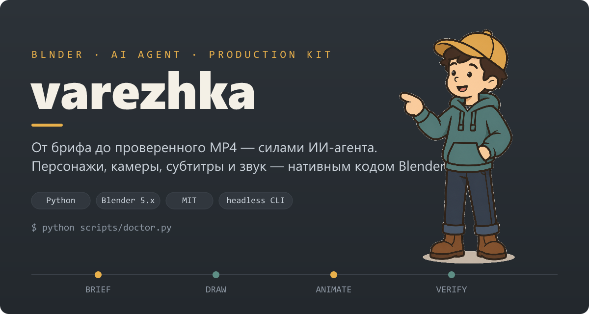
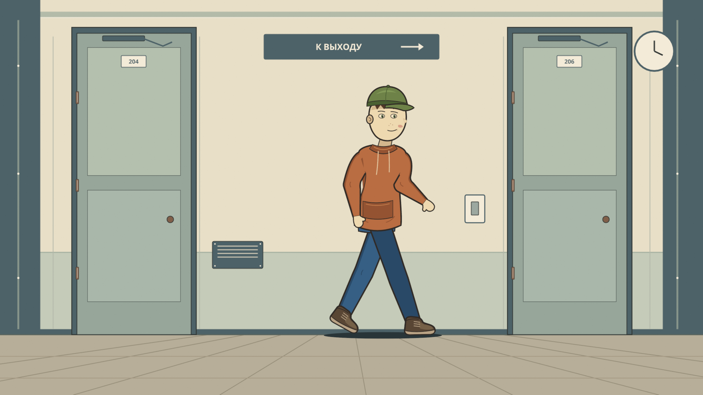
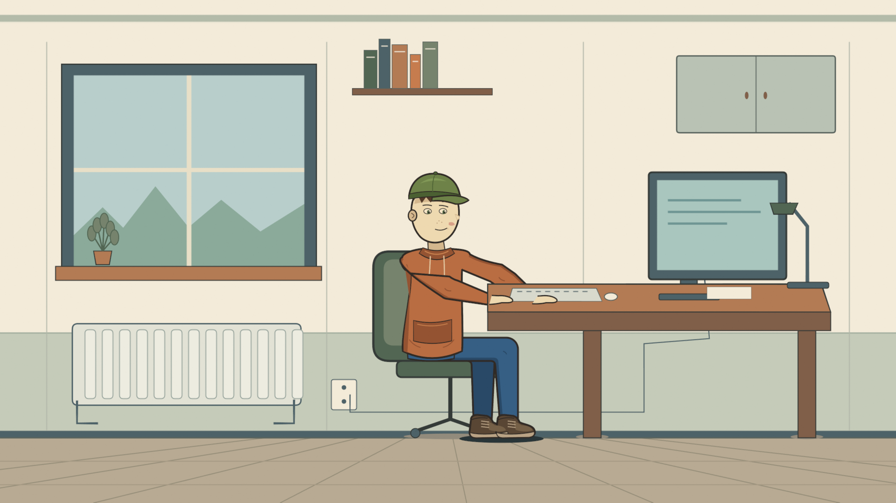
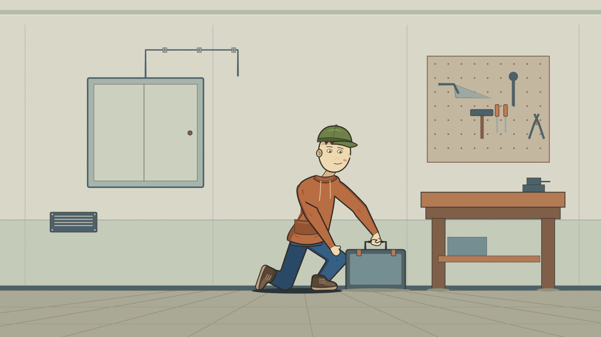
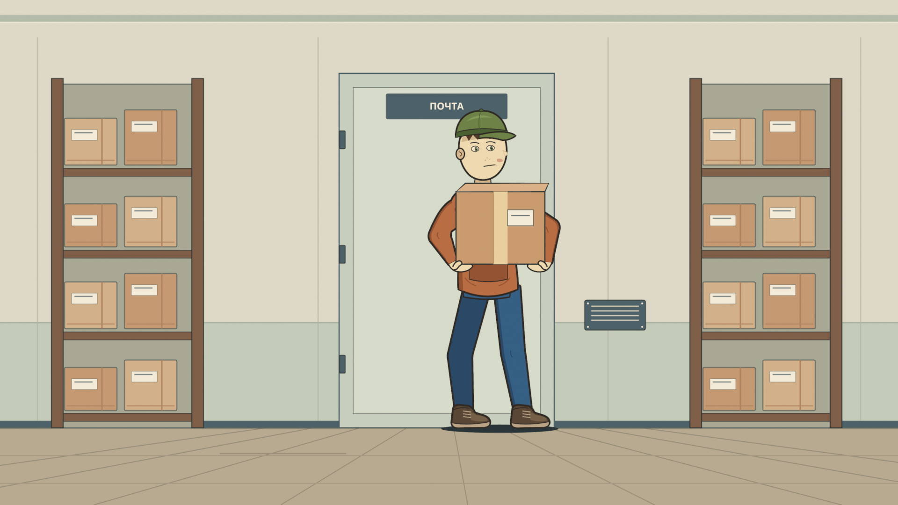
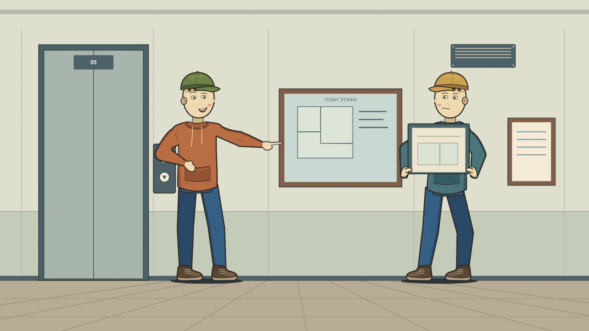
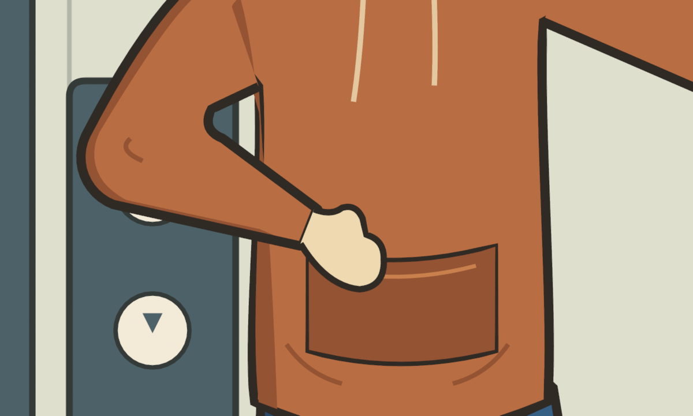
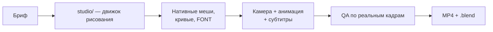

<div align="center">



# varezhka

**Переносная студия мультфильмов для ИИ-агента: от брифа до проверенного MP4.**

Персонажи, интерьеры, камеры, субтитры и звук — всё рисуется и анимируется
нативным кодом Blender. Никаких растровых заготовок — только редактируемые
меши, кривые и FONT-объекты.

[Быстрый старт](#быстрый-старт) · [Как это работает](#как-это-работает) · [Доказательства](#доказательства) · [CI](#ci) · [Лицензия](#лицензия)

</div>

---

## Доказательства

Всё ниже отрендерено кодом из этого репозитория на Blender 5.x в headless-режиме.

| Коридор | Рабочее место | Мастерская |
|:---:|:---:|:---:|
|  |  |  |

| Переноска коробки | Объяснение плана | Кисть-варежка |
|:---:|:---:|:---:|
|  |  |  |

**Видео-пробы:** [камера, 9 сек, 1080p](examples/camera-study-9s.mp4) · [moving hold, 3 сек](examples/moving-hold-3s.mp4)

> Честные границы: это статичные позы и пробы движения. Не цикл ходьбы, не липсинк, не готовый фильм.

## Что это

`varezhka` — портативный производственный комплект. Откройте папку агенту, дайте
стартовый промпт — агент уточнит бриф (формат, стиль, длительность, звук), предложит
идею и поведёт производство от сценария до рендера, проверяя реальные кадры.

Название — от «варежки»: фирменный стиль кистей персонажей (одна округлая форма
с коротким большим пальцем, без отдельных пальцев).

## Как это работает



| Слой | Файлы | Роль |
| --- | --- | --- |
| 2D-примитивы | `studio/blender_flat.py` | Экранные координаты, ортокамера, слои Z |
| Персонажи | `studio/draw_people.py`, `draw_mitten_hands.py` | 5 поз, анатомически честные руки, кисти-варежки |
| Интерьеры | `studio/draw_rooms.py` | 5 сцен с функциональными деталями |
| Анимация | `studio/build_animation.py` | Moving hold с инвариантом дрейфа стоп |
| Субтитры | `studio/captions.py` | Слова/фразы, привязка к камере драйверами |
| CLI | `scripts/render_example.py` | Прогон примеров через локальный Blender |
| Проверка | `scripts/doctor.py` | Проверка окружения без секретов |

## Быстрый старт

Требования: Python 3.11+, локальный Blender, ffmpeg для MP4.

```bash
# 1. Проверить окружение
python scripts/doctor.py

# 2. Пять статичных сцен + .blend
python scripts/render_example.py --mode stills --output output/stills --blender "PATH_TO_BLENDER"

# 3. Проба камеры (9 сек) с кодированием
python scripts/render_example.py --mode camera --output output/cam --blender "PATH_TO_BLENDER" --encode

# 4. Проверить целостность пакета
python scripts/verify_package.py
```

Путь к Blender задаётся флагом `--blender` или переменной `BLENDER_PATH`.
Быстрая проверка — добавьте `--percent 50`. Полный список режимов: `--help`.

**Для агента:** вставьте текст из [`prompts/START-HERE.txt`](prompts/START-HERE.txt).
Агент найдёт скиллы в `skills/`, задокументированный процесс в `docs/` и проверит
инструменты перед производством.

## CI

Каждый пуш и PR прогоняются через жёсткий конвейер (`.github/workflows/ci.yml`):

1. **verify** — SHA-256 каждого файла против манифеста.
2. **render** — реальные рендеры на Blender в Actions: 5 сцен, камера, moving hold
   с проверкой инварианта дрейфа стоп.
3. **manifest-sync** — манифест не разъезжается с деревом файлов.

Релизы тегами: `.github/workflows/release.yml` собирает проверенный ZIP-артефакт.

## Структура

```text
varezhka/
├── prompts/START-HERE.txt   # главный промпт для агента
├── skills/                  # cartoon-blender-production, cartoon-visual-qa
├── studio/                  # Python-движок рисования для Blender
├── scripts/                 # doctor, render_example, verify_package, voice
├── docs/                    # бриф, стиль, анимация, звук, безопасность
├── templates/               # brief.json, сценарий, раскладка кадров
├── examples/                # проверенные рендеры и видео-пробы
├── assets/                  # SFX, шрифты Noto Sans (OFL), readme-графика
└── references/              # исходные PDF и MIT-скиллы с лицензиями
```

## Голос и ключи

Озвучка ElevenLabs опциональна. Ключ — только через переменную окружения
`ELEVENLABS_API_KEY`, никогда в чат или промпт. Проверка без сети:

```bash
python scripts/elevenlabs_voice.py --voice-id ID --text-file templates/voice-sample.txt \
  --output output/voice.mp3 --dry-run
```

## Лицензия

[MIT](LICENSE). Шрифты Noto Sans — под [OFL](assets/fonts/LICENSE-OFL.txt).
Источники сторонних компонентов — в [THIRD-PARTY-NOTICES.md](THIRD-PARTY-NOTICES.md).
